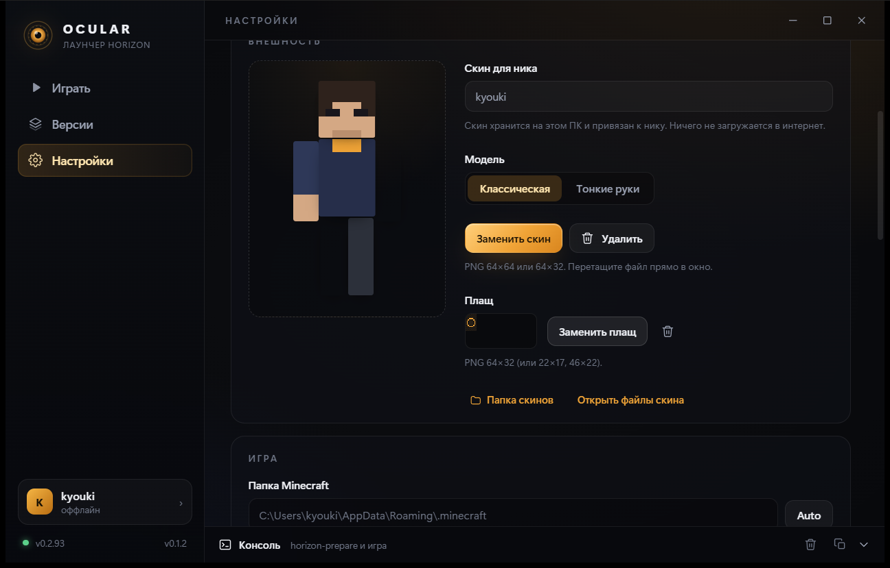

**[Русский](README.ru.md)** · **English**

# Ocular Launcher

A launcher for [Horizon](https://github.com/horizon-rust/horizon) — Minecraft: Java Edition 26.3, rewritten in Rust.

Ocular installs Horizon releases from GitHub, prepares their resources from your own copy of Minecraft, and starts the game. **It has no Microsoft sign-in: you play offline, under your own nickname.** An unofficial project, not affiliated with Mojang, Microsoft or the Horizon team.


## Offline first: no Microsoft account, ever

This is the point of Ocular, not a gap in it.

- **No Microsoft account.** No sign-in window, no tokens, no keychain, no "log in to play" gate. Ocular will never ask for your Microsoft password.
- **Nothing leaves your PC.** The launcher talks to GitHub (to fetch Horizon releases) and to Mojang (to fetch the two files `horizon-prepare` needs); your nickname, skins, worlds and settings stay on this computer. No telemetry, no analytics, no accounts server.
- **Your name is yours.** Pick any offline nickname — 3 to 16 Latin letters, digits or `_` — and play instantly. Switch between names in Settings whenever you like.
- **Skinned without the network.** A skin and a cape are plain PNG files next to your name. Load them from disk, and the game gets them on launch — no upload, no moderation, no waiting.
- **Works without internet** once Horizon is installed and prepared: single player, your own worlds, and LAN play. Only installing, updating and first-time preparation need a connection.
- **Online-mode servers are out of reach** — Mojang requires a Microsoft session to join them. That is a property of the offline mode, not something Ocular can change. Offline-mode servers (including Horizon servers) accept your nickname.

## What works today

- **Versions** — the game's GitHub releases (`vX.Y.Z`), downloaded, unpacked into `versions/<tag>/`, removable.
- **Game preparation** — `horizon-prepare` from the installed release; Mojang's exact `version JSON` by its pinned hash from `research-lock.json`; `server.jar` downloaded automatically; `libraries`/`assets` linked instead of copied.
- **Play** — the selected version, your offline nickname (`--name`), its own `HORIZON_HOME`, the game's output streamed into the launcher console, a Stop button.
- **Local skins** — a per-nickname skin and cape on disk, a preview built from the texture, classic/slim, file picker or drag-and-drop. Horizon 0.2.93 does not read `HORIZON_OFFLINE_SKIN` yet, so the launcher writes the skin into the prepared default player textures (originals kept for rollback) — no resource pack, no cache rebuild.
- **Game updates** — an "Update available" banner on Play; prepared resources are carried over, so updating never re-prepares anything.
- **Launcher updates** — signed, from `latest.json` in this repository, verified with minisign before install.
- **Console** — preparation and game output, clear and copy.
- **Settings** — nickname, Minecraft folder, Java for preparation, sound copying, extra game arguments, language (ru / en / system), quick access to every folder.
- **Look** — a dark, amber "iris" theme with a custom title bar; Play, Versions and Settings pages.

| Game | Appearance | Versions |
| --- | --- | --- |
|  |  |  |

## Requirements

- Windows 10/11 x64 and WebView2 (already present on Windows 11).
- **Your own copy of Minecraft: Java Edition 26.3** — the client and assets on disk. Ocular never downloads or redistributes game files; the few Mojang files it fetches itself (the official `version JSON`, the asset index, `server.jar`) are checked against the hashes in `research-lock.json`.
- **Java 25** — only for preparing resources (once per Minecraft version). The launcher finds it itself (`JAVA_HOME`, PATH, `Program Files`). The game needs no Java at all.

### Where the Minecraft install comes from

The official launcher is not required — Ocular reads its folder by default (`%APPDATA%\.minecraft`) or the one you choose in Settings. Installs made by Prism Launcher, MultiMC, ATLauncher, CurseForge or the Modrinth App work too, as long as they hold an **original 26.3 client** (`versions\26.3\26.3.jar`, not patched) and the `assets` folder. You do not need to launch the game from the official launcher first.

### Online mode in the game itself

Horizon's own options have an "Online mode" switch: on, the game talks to Mojang's services; off, it talks to nothing. Ocular leaves that setting to you.

## Development

```powershell
npm install
npm run tauri dev      # the launcher window + Vite (http://127.0.0.1:1420)
npm run build          # frontend only (tsc + vite)
npm run tauri build    # NSIS installer in src-tauri/target/release/bundle/
```

Requires Rust (stable, MSVC) and Visual Studio Build Tools with the "Desktop development with C++" workload (MSVC + Windows SDK).

## How it is built

```
Ocular Launcher/
  src/                     React + TypeScript UI
    pages/                 Play, Versions, Settings
    components/            Sidebar, TitleBar, ConsoleDock, SkinPreview, Iris, Icons
    lib/                   api (invoke), store (zustand), i18n, types
  src-tauri/               Rust backend
    src/lib.rs             Tauri commands and the app state
    src/install.rs         downloading and unpacking releases
    src/prepare.rs         server.jar, the Minecraft mirror, horizon-prepare
    src/game.rs            starting/stopping the game, streaming its log
    src/skins.rs           per-nickname skin and cape, texture patching
    src/releases.rs        GitHub API and its cache
    src/java.rs            finding Java 25
    src/paths.rs           the data layout
  tools/make_icon.py       the app icon (Pillow)
```

### Launcher data

`%LOCALAPPDATA%\Ocular Launcher\`:

| Path | Contents |
| --- | --- |
| `settings.json` | settings |
| `versions/<tag>/` | an unpacked Horizon release and its prepared `.local/` |
| `cache/releases.json` | the release list cache (10 minutes) |
| `cache/downloads/` | downloaded archives |
| `server-jars/26.3-server.jar` | the pinned server jar |
| `minecraft/` | the Minecraft mirror: Mojang's version JSON, a hard link to the client, junctions to `libraries`/`assets` |
| `game/` | `HORIZON_HOME`: worlds, options.txt, logs, screenshots, skins |

### Why a Minecraft mirror of its own

`horizon-prepare` checks the client and the version JSON against `research-lock.json`. When Mojang republishes a version JSON (it does), or when another launcher patched the install, preparation fails. Ocular instead:

1. reads `accepted_manifest_sha1` from the installed release's `research-lock.json` and downloads the **exact** version JSON from `piston-meta.mojang.com` by its content-addressed URL;
2. checks the player's client jar against `client_sha1` and hard-links it instead of copying;
3. links `libraries` and `assets` with junctions;
4. downloads the pinned asset index and `server.jar` from Mojang.

Preparation therefore never depends on whatever sits in the player's `versions/26.3/26.3.json`.

## Differences from Horizon's own launcher

| | Horizon launcher (GPUI/Rust) | Ocular (Tauri/React) |
| --- | --- | --- |
| Stack | Rust + GPUI | Rust + Tauri 2, React 19, TypeScript |
| Accounts | Microsoft OAuth, system keychain | offline nickname only — by design, no Microsoft |
| Instances, worlds, mods, servers | available | on the roadmap |
| Preparation | own logic + import from versions | a mirror + the pinned manifest |
| Size | ~19 MB | a Tauri build, WebView2 from the system |

## Updating the launcher

Ocular checks `latest.json` in [this repository's releases](https://github.com/sixtharrancar999/ocular-launcher/releases) at start-up and from Settings. The downloaded installer is verified against its minisign signature; then the launcher restarts.

- The public key lives in `src-tauri/tauri.conf.json` (`plugins.updater.pubkey`).
- The private key stays outside the repository (`%USERPROFILE%\.tauri\ocular-launcher.key`) and in GitHub → **Settings → Secrets and variables → Actions** as `TAURI_SIGNING_PRIVATE_KEY`.
- Releasing: bump the version in `package.json`, `src-tauri/Cargo.toml` and `src-tauri/tauri.conf.json`, commit, tag `vX.Y.Z` and push the tag. GitHub Actions builds the NSIS installer, signs it and publishes the release with `latest.json`.
- Keep the private key: without it no future update can be signed. Already installed copies keep working.
- Step by step, including manual releases: [docs/release.md](docs/release.md).

## Roadmap

- [x] **Game and launcher updates** — the game updates with its prepared resources carried over; the launcher updates from its own signed `latest.json`.
- [x] **Local skins** — a skin and a cape on this PC, a preview in the launcher, classic/slim.
- [ ] **Instances** — separate `HORIZON_HOME` folders with their own worlds, settings and a copyable profile.

That is all of it. Microsoft OAuth, mods, server hosting, macOS/Linux builds and telemetry are not planned. Details: [docs/roadmap.md](docs/roadmap.md) · [по-русски](docs/roadmap.ru.md).

## Licence

Ocular's own code is MIT. Horizon is MIT (its own code). Minecraft is a trademark of Mojang; game files are not part of this repository and are never redistributed.
