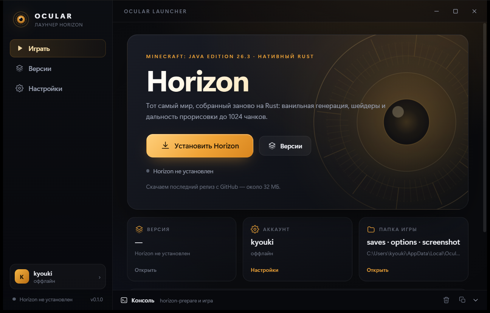
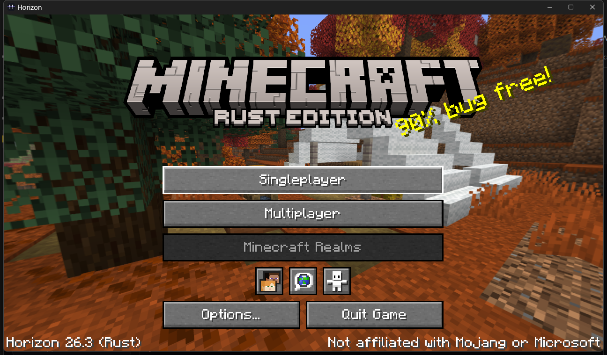
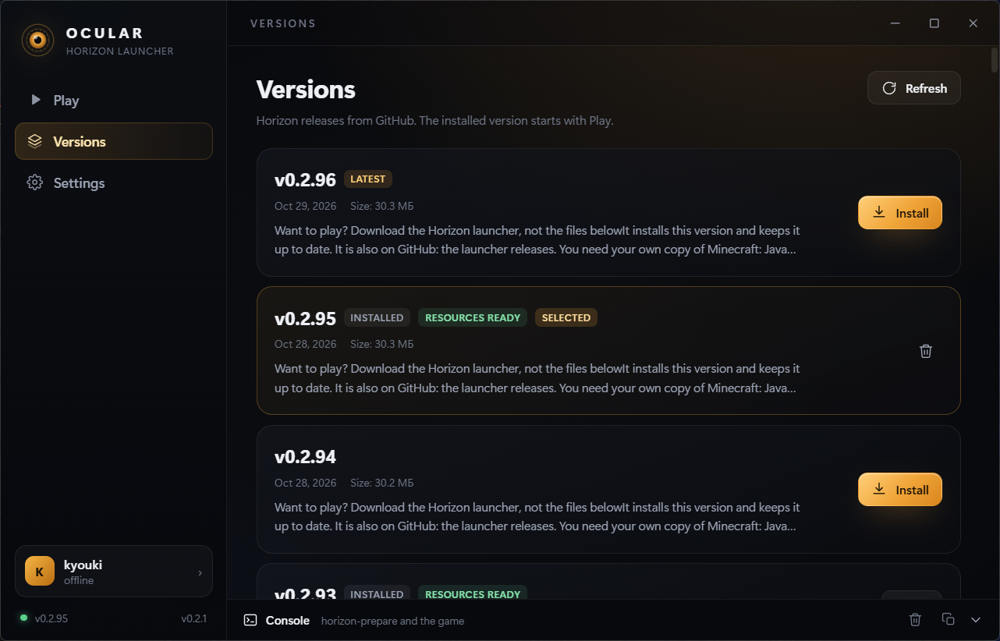

# Ocular Launcher

Свой лаунчер для [Horizon](https://github.com/horizon-rust/horizon) — Minecraft: Java Edition 26.3, переписанной на Rust.

Ocular ставит релизы Horizon с GitHub, готовит ресурсы из вашей собственной копии Minecraft и запускает игру. Это неофициальный проект, не связанный с Mojang, Microsoft или командой Horizon.



| Игра | Версии |
| --- | --- |
|  |  |

## Что уже работает (MVP)

- **Установка версий**: список игровых релизов Horizon с GitHub (`vX.Y.Z`), скачивание Windows-архива, распаковка в `versions/<tag>/`, удаление.
- **Автообновление лаунчера**: проверка `latest.json` из GitHub Releases, баннер на Play и раздел «Обновления» в настройках; скачивание, проверка подписи и перезапуск через `tauri-plugin-updater`.
- **Обновление игры**: баннер «Доступно обновление» на Play, обновление в один клик; уже подготовленные ресурсы переносятся из предыдущей версии (hardlink), повторная подготовка не нужна.
- **Подготовка ресурсов**: `horizon-prepare` из установленного релиза, официальный `version JSON` Minecraft по закреплённому хешу из `research-lock.json`, автоматическая загрузка `server.jar` с Mojang, зеркало `libraries`/`assets` через junction-ссылки (без копирования гигабайтов).
- **Запуск игры**: выбранная версия, оффлайн-никнейм (`--name`), отдельная папка `HORIZON_HOME`, потоковый вывод игры в консоль лаунчера, остановка процесса.
- **Консоль**: вывод `horizon-prepare` и игры, очистка, копирование.
- **Настройки**: никнейм, папка Minecraft, Java для подготовки, копирование звуков, дополнительные аргументы игры, язык (ru/en/system), быстрый доступ к папкам.
- **UI**: тёмная тема с янтарным «ирисом», кастомный заголовок окна, страницы Play / Versions / Settings.

## Требования

- Windows 10/11 x64 и WebView2 (в Windows 11 уже есть).
- **Java 25** — только для подготовки ресурсов; лаунчер находит её сам (`JAVA_HOME`, PATH, `Program Files`).
- Своя легальная копия **Minecraft: Java Edition 26.3**, хотя бы раз запущенная официальным лаунчером. Ocular не скачивает и не распространяет файлы игры.
- Аккаунт Microsoft пока не нужен: MVP играет под оффлайн-никнеймом.

## Разработка

```powershell
npm install
npm run tauri dev      # окно лаунчера + Vite (http://127.0.0.1:1420)
npm run build          # только фронтенд (tsc + vite)
npm run tauri build    # установщик NSIS в src-tauri/target/release/bundle/
```

Требуется Rust (stable, MSVC) и Visual Studio Build Tools с workload «Разработка классических приложений на C++» (MSVC + Windows SDK).

## Как это устроено

```
Ocular Launcher/
  src/                     React + TypeScript UI
    pages/                 Play, Versions, Settings
    components/            Sidebar, TitleBar, ConsoleDock, Iris, Icons
    lib/                   api (invoke), store (zustand), i18n, types
  src-tauri/               Rust-бэкенд
    src/lib.rs             команды Tauri и сборка состояния
    src/install.rs         скачивание и распаковка релизов
    src/prepare.rs         server.jar, зеркало Minecraft, horizon-prepare
    src/game.rs            запуск/остановка игры, стриминг логов
    src/releases.rs        GitHub API + кеш
    src/java.rs            поиск Java 25
    src/paths.rs           раскладка данных
  tools/make_icon.py       иконка (Pillow)
```

### Данные лаунчера

`%LOCALAPPDATA%\Ocular Launcher\`:

| Путь | Что там |
| --- | --- |
| `settings.json` | настройки |
| `versions/<tag>/` | распакованный релиз Horizon и `.local/` с ресурсами |
| `cache/releases.json` | кеш списка релизов (10 минут) |
| `cache/downloads/` | скачанные архивы |
| `server-jars/26.3-server.jar` | закреплённый server.jar |
| `minecraft/` | зеркало установки Minecraft: официальный version JSON, hardlink на клиент, junction на `libraries`/`assets` |
| `game/` | `HORIZON_HOME`: миры, options.txt, логи, скриншоты |

### Почему своё зеркало Minecraft

`horizon-prepare` сверяет SHA-1 клиента и version JSON с `research-lock.json`. Если официальный лаунчер переопубликовал JSON (а он это делает), либо установка «пропатчена» сторонним лаунчером, подготовка падает. Ocular:

1. берёт `accepted_manifest_sha1` из `research-lock.json` установленного релиза и скачивает **точный** version JSON с `piston-meta.mojang.com` по content-addressed URL;
2. проверяет клиентский jar игрока по `client_sha1` (не копирует, а делает hardlink);
3. подключает `libraries` и `assets` игрока junction-ссылками;
4. скачивает закреплённый asset index и `server.jar` с Mojang.

Так подготовка не зависит от того, что лежит в `versions/26.3/26.3.json` у игрока.

## Отличия от оригинального лаунчера

| | Horizon launcher (GPUI/Rust) | Ocular (Tauri/React) |
| --- | --- | --- |
| Стек | Rust + GPUI | Rust + Tauri 2, React 19, TS |
| Аккаунты | Microsoft OAuth, ключница | только оффлайн-ник — осознанно, без Microsoft |
| Инстансы, миры, моды, серверы | есть | в roadmap |
| Подготовка | своя логика + импорт из версий | зеркало + закреплённый manifest |
| Размер | ~19 МБ | Tauri-сборка, WebView2 из системы |

## Обновление лаунчера

Лаунчер проверяет `latest.json` из [релизов репозитория](https://github.com/sixtharrancar999/ocular-launcher/releases) при старте и по кнопке в настройках. Скачанный установщик проверяется по minisign-подписи, затем лаунчер перезапускается.

- Публичный ключ лежит в `src-tauri/tauri.conf.json` (`plugins.updater.pubkey`).
- Приватный ключ — `%USERPROFILE%\.tauri\ocular-launcher.key`; в репозиторий он не попадает. Его содержимое нужно добавить в GitHub → **Settings → Secrets and variables → Actions** как `TAURI_SIGNING_PRIVATE_KEY`.
- Выпуск версии: поднять версию в `package.json`, `src-tauri/Cargo.toml`, `src-tauri/tauri.conf.json`, закоммитить, поставить тег `vX.Y.Z` и запушить его. GitHub Actions соберёт NSIS-установщик, подпишет его, создаст релиз и `latest.json`.
- Приватный ключ нужно сохранить: без него нельзя подписать следующие обновления. Уже установленные копии продолжат работать.

## Roadmap

1. **Автообновление игры и лаунчера**: оба готовы — игра обновляется с переносом ресурсов, лаунчер — из `latest.json` собственного репозитория с проверкой подписи.
2. **Локальные скины**: скин и плащ хранятся на ПК, лаунчер показывает превью и позволяет менять скин (classic/slim), игра получает его через `HORIZON_OFFLINE_SKIN`.
3. **Инстансы**: отдельные папки `HORIZON_HOME`, миры, настройки и копирование инстанса.

Всё. Microsoft OAuth, моды, серверы и кроссплатформенные сборки в планы не входят.

## Лицензия

Код Ocular — MIT. Horizon — MIT (его собственный код). Minecraft — торговая марка Mojang; файлы игры не входят в репозиторий и не распространяются.
